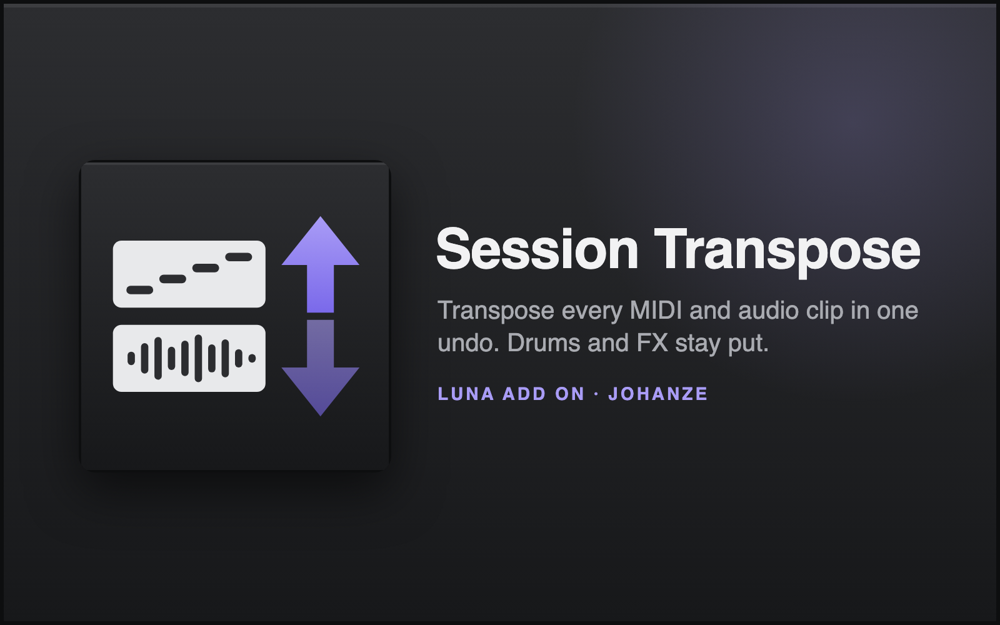

# Session Transpose for LUNA



Transpose a whole LUNA session up or down by up to an octave: every MIDI clip and every audio
clip moves, in one undo step, and the tracks you don't want touched (drums, FX, risers...)
are skipped.

Needs LUNA 3.1.2 or later, on macOS.

## Install

Download `session-transpose.lunaaddon` from the
[latest release](https://github.com/johanze-ops/session-transpose/releases/latest) and
double-click it, and LUNA installs it. Then open **Add Ons > Browsers > Session Transpose**.
It opens in the right-hand browser panel.

## Use

- **Pick an amount:** press **+** / **−** (or ↑ / ↓), or click the number and type one
  (`-5`, `7`), from −12 to +12 semitones.
- **Apply:** every clip on the ticked tracks moves to that amount. MIDI notes are shifted and
  audio clips are pitch-shifted by LUNA without changing their length or timing. It's one
  undo step, so **Undo** in LUNA puts everything back.
- **Back to 0** returns every clip to where it started. The amount is the session's
  transpose, not a nudge: applying +3 and then +5 leaves the session at +5, not +8.
- **Skip tracks:** tracks whose names contain one of the tags are skipped, and so are tracks
  inside a folder whose name contains one. The starting tags are drum, kick, snare, hat,
  perc, 808, clap, rim, tom, cymbal, shaker and loop. Remove one with its ×, add your own
  (`fx`, `crash`, `white noise`...) in the box, or **Reset to defaults**. Your tag list is
  kept for all your sessions.
- **Tick or untick a track** in the list to include or skip it whatever the tags say (for a
  snare called "big SN", say). That's saved with the session.

The list shows what will change: each track's MIDI and audio clip count and where it's at, or
why it's skipped.

## Good to know

- Each clip remembers how far it was moved, saved with the session, so clips you add later
  start at 0 and catch up on the next Apply, and **Back to 0** is exact even after you
  reopen the session.
- If a shift would push MIDI notes past the MIDI range (below 0 or above 127), nothing is
  changed and the panel says which tracks.
- Audio clips keep any pitch you'd already given them in LUNA; the transpose goes on top.
- Your tag list lives in the Add On's own storage, which a reinstall or update clears. Each
  session you've used it in keeps a copy, and opening one brings the tags back.

## Develop

```sh
npm install
npm test            # runs against the SDK's mock engine, no LUNA needed
npx ua-builder serve
npx ua-builder install
```

Built with UA's [LUNA Builder SDK](https://github.com/uaudio-labs/luna-builder-sdk).
`vendor/luna.global.js` is UA's SDK under the Apache License 2.0 (see
`vendor/LICENSE-luna-builder-sdk` and `vendor/NOTICE-luna-builder-sdk`); everything else is
MIT, by JOHANZE.
